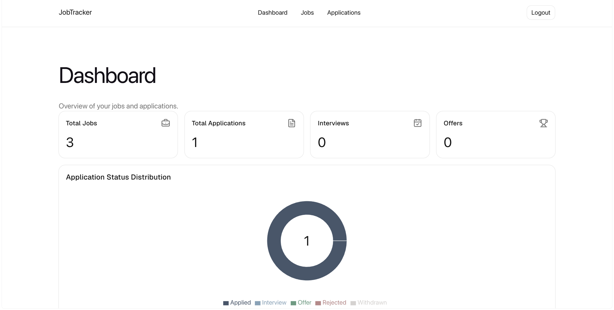
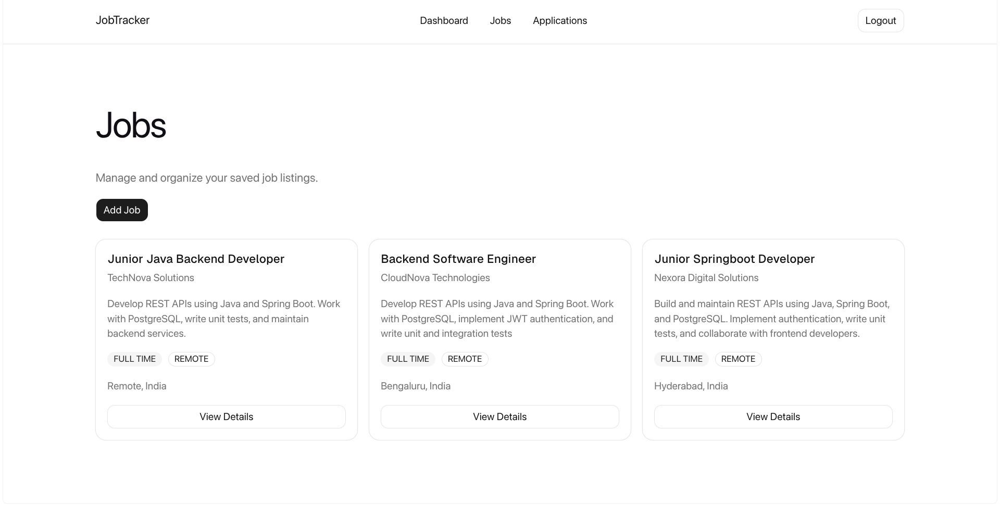
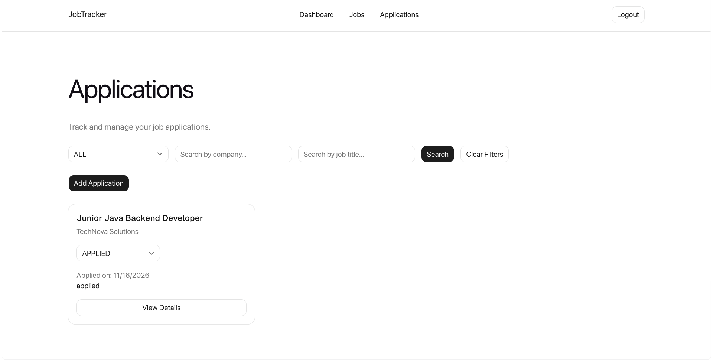

# JobTracker — Frontend

A job application tracking interface built with React and TypeScript, backed by a Spring Boot REST API.

**[Live Demo](https://jobtracker-ajay.vercel.app)** · **[Backend Repository](https://github.com/ajayanuragi/job-tracker)**

## Overview

JobTracker helps users save job listings, track applications, and see their progress on a dashboard.

## Features

- **Authentication:** Register, log in, access protected routes, and return to login after an authenticated API request receives a `401` response.
- **Job listings:** Browse, create, and view job details.
- **Applications:** Create applications, view details, update statuses, and filter by status, company, or job title.
- **Dashboard:** View totals for jobs, applications, interviews, and offers; browse recent applications; and explore an application-status donut chart.
- **Navigation:** Open filtered application lists directly from dashboard statistics.
- **UI states:** Loading placeholders, empty states, and error messages.

## Screenshots

### Dashboard



### Jobs



### Applications



## Tech Stack

| Area | Technologies |
| --- | --- |
| Framework | React, TypeScript, Vite |
| Styling | Tailwind CSS, shadcn/ui |
| Routing | React Router |
| Data fetching | TanStack Query, Axios |
| Forms | React Hook Form, Zod |
| Charts and icons | Recharts, Lucide React |
| Package manager | Bun |
| Hosting | Vercel |

## Local Development

### Prerequisites

- [Bun](https://bun.sh/)
- A running [JobTracker backend](https://github.com/ajayanuragi/job-tracker) or its hosted API

### Setup

```bash
git clone https://github.com/ajayanuragi/job-tracker-frontend.git
cd job-tracker-frontend
bun install
```

Create a `.env.local` file in the project root:

```env
VITE_API_BASE_URL=http://localhost:8080
```

To use the deployed backend instead:

```env
VITE_API_BASE_URL=https://job-tracker-v83k.onrender.com
```

Start the development server:

```bash
bun run dev
```

Open `http://localhost:5173`.

## Checks

```bash
bun run build
bun run lint
```

## Deployment

The frontend is deployed on [Vercel](https://vercel.com/) at **https://jobtracker-ajay.vercel.app**. Set `VITE_API_BASE_URL` to the backend's public base URL in the Vercel project's environment variables, then build and deploy the Vite application.

The Spring Boot backend is hosted on Render and uses PostgreSQL on Neon. The backend must allow the deployed frontend origin in its CORS configuration.

## Backend

See [job-tracker](https://github.com/ajayanuragi/job-tracker) for the API implementation, authentication, database configuration, and backend tests.
